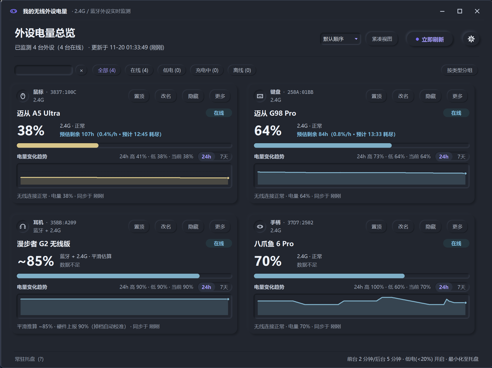
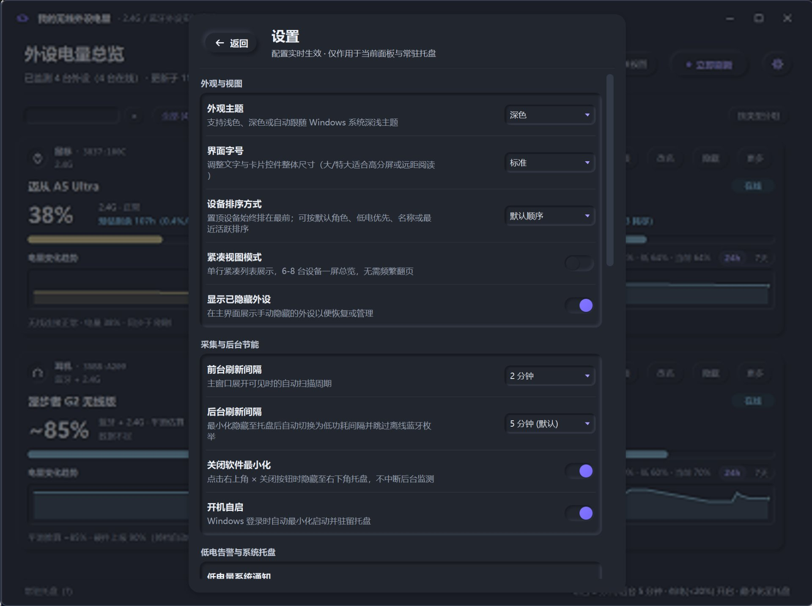
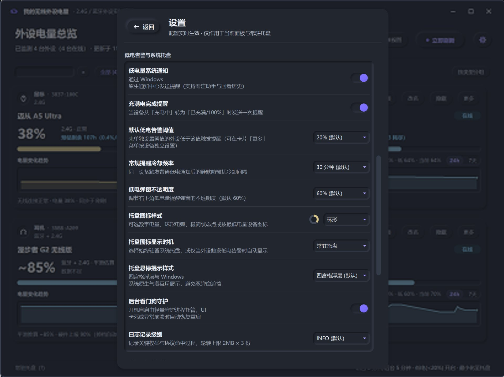

# PeripheralBatteryViewer —— Windows 2.4G / 蓝牙无线外设电量监视器

纯 Python 标准库 + `ctypes` + `tkinter` 实现（**零第三方依赖**，无需安装 `hidapi` / `pystray` / `Pillow`）。一次性监视鼠标、键盘、耳机、手柄的剩余电量，带低电提醒、历史趋势与续航预估。

---

## 功能一览

| 能力 | 说明 |
|---|---|
| 多设备总览 | 一张面板同时显示所有无线外设的电量、连接方式和在线状态，按角色区分图标 |
| 实时刷新 | 手动刷新 + 前台定时扫描；热插拔自动感知；窗口隐藏时自动降低到后台刷新频率 |
| 电量趋势 | 每台设备 24 小时 / 7 天 / 14 天 / 30 天平滑抗锯齿历史曲线，悬浮胶囊查看任意时间点数值 |
| 续航预估 | 依据真实掉档历史回归出耗电速率，给出「预计剩余 X 小时」（耳机切纯 2.4G 模式自动按功耗 +50% 修正）；充电时给出充满时间 |
| 低电告警 | 分级低电（普通/紧急/严重）+ 充满电提醒，支持单设备独立阈值、告警历史统计报表、冷却时间与一键暂缓 |
| 搜索过滤 | 支持按名称/型号/VID:PID 搜索，按在线/低电/充电中/离线状态过滤，以及按外设类型折叠分组 |
| 系统托盘 | 常驻托盘，图标动态显示最低设备电量（数字/环形/圆点等多种样式）；悬停四宫格速览 |
| 协议标定 | 内置调试工具，可探测 HID 报告、手工标定并保存任意 HID 设备的电量协议 |
| 双模合并 | 同一台设备的蓝牙与 2.4G 接收器自动合并为一张卡片，避免重复显示 |

---

## 功能截图

### 主面板：外设电量总览

四台设备同屏显示（鼠标 / 键盘 / 耳机 / 手柄），含电量百分比、连接模式、状态胶囊、续航预估与 24 小时电量趋势。顶部可按在线状态筛选、切换紧凑视图、立即刷新。

### 托盘悬停速览

鼠标悬停托盘图标即弹出四宫格，快速查看各设备电量，无需打开主窗口。

### 设置：外观与采集

支持主题（跟随系统 / 浅色 / 深色）、字号、排序、紧凑视图；前台与后台刷新间隔独立配置；可设置关闭时最小化到托盘、开机自启。

### 设置：低电告警与托盘

低电系统通知、充满提醒、独立告警阈值、提醒冷却、弹窗透明度、托盘图标样式与显示时机、后台看门守护均可配置。

---

## 启动方式

- **主面板**：双击 `我的设备电量.bat` 或运行 `pythonw.exe my_devices.py`
- **命令行快查**：`python.exe my_devices.py --once`（加 `--json` 输出 JSON）
- **系统托盘驻留**：双击 `启动托盘后台.bat` 或运行 `pythonw.exe tray_app.py`（支持 `--status` / `--refresh` / `--quit`）
- **协议调试与手动标定**：双击 `外设调试与标定.bat` 或运行 `pythonw.exe app.py`（支持 `--list` / `--battery` / `--bt` / `--dump VID:PID`）
- **打包后的 exe**：直接运行 `外设电量查看器.exe`，同样支持上述全部命令行参数

## 已支持协议

1. **迈从 MCHOSE 鼠标**（`3837:100C` A5 Ultra 等）：`0xFF01` 65 字节 Feature Report `0x11/0x06`（兼容明文 `0x06` 与 RealTek 按位取反 `0xF9` 响应，带休眠检测）。
2. **SinoWealth / MCHOSE 20B 无线键盘**（`258A:01BB`、`3554:FA09` 等）：`0xFF02` 20 字节 `0x13 0x05/0x4A` 帧与字节求和校验。
3. **飞智 Flydigi 手柄**（`37D7:2502` APEX 6 Pro 等）：`0xFFA0` 33 字节 `5A A5 01` 查询帧，自动识别有线 / 2.4G / 蓝牙连接模式。
4. **通用 2.4G 与蓝牙外设兼容**：ATK / VXE / VGN (`373B:*`/`3554:*`)、罗技 HID++ 2.0 (`046D:*`)、Sony DualSense / DS4 (`054C:*`)、Razer (`1532:*`)、SteelSeries (`1038:*`)、Microsoft Surface / 标准 HID 电量用法 (`045E:*`、`0x0006/0x0020`、`0x0085`)、DARKRIM / 杰理 RCSP (`3654:6901` 等)、Windows 蓝牙 HFP PnP 节点、BLE GATT 电池服务 (`0x180F`/`0x2A19`)，以及通过用户协议文件手动标定的任意 HID 设备。

---

## 关于双模设备：2.4G 模式读不到电量怎么办？

不少无线耳机 / 鼠标同时支持蓝牙和 2.4G 两种连接方式（例如漫步者 G2 无线版）。**其 2.4G 接收器往往只在固件里上报连接状态，并不回传电量数据**，因此刚切到 2.4G 时面板上会显示「数据不足」或沿用旧值。

**处理办法：先用蓝牙模式正常使用一段时间，再切回 2.4G。**

原理与行为：

1. **先积累数据**：设备处于蓝牙模式时，程序能读到蓝牙电量（经典蓝牙 HFP 通常是 10% 一档的步进值）。这些读数会持续写入本地电量历史。
2. **自动学习耗电速率**：程序从你真实使用的掉档记录里回归出这台设备的实际耗电速度（%/小时）。使用时间越长、掉档次数越多，估算越准；尚未掉档时采用保守默认值。
3. **平滑推算**：基于学习到的速率，把 10% 步进的粗粒度读数插值成 1% 的平滑电量，面板上以 `~85%` 形式显示（带波浪号表示估算值）。卡片脚注会同时给出「平滑推算 ~85% · 硬件上报 90%（掉档自动校准）」。
4. **自动校准**：每次蓝牙硬件上报新的掉档值时，估算自动归零重建，不会累积漂移。
5. **切回 2.4G 后**：接收器虽不回传电量，但设备仍在线——程序会把之前学到的电量水平沿用过来并显示「2.4G 在线（沿用上次蓝牙电量）」，针对耳机在纯 2.4G 模式下功耗增加 50% 的特性自动按蓝牙基线速率 × 1.5 继续估算续航。想刷新精确电量时，临时切回蓝牙模式同步一次即可。

> 支持硬件电量回传的 2.4G 设备（如迈从 A5 Ultra、迈从 G98 Pro 等）不受此限制，切到 2.4G 也能直接读到真实电量。

---

## 数据存储

所有数据均为本地存储（非便携安装默认位于 `%APPDATA%\PeripheralBatteryViewer`，便携目录带历史文件时自动原地读写），不上传网络：

- `tray_config.json`：界面、单设备阈值与告警配置
- `battery_history.json`：电量历史（支持 1 / 3 / 7 / 14 / 30 天保留策略，默认 7 天）
- `alert_history.json`：低电/充满告警事件与持续时长统计
- `app_error.log`：轮转运行日志

## 更新日志（v1.1.2）

- 新增单设备独立低电阈值、充满电提醒、告警历史统计报表、搜索/状态过滤/类型分组、`14天/30天` 趋势时间窗及功耗/等效循环估算
- 新增耳机切纯 `2.4G` 模式功耗 `+50%` 续航估算、飞智有线 USB 模式识别，以及 Sony / Razer / SteelSeries / Surface 协议支持
- 趋势曲线升级为单调三次样条平滑 + SDF 亚像素抗锯齿渐变填充，悬浮时间改为圆角新拟物胶囊且自动贴边防裁切
- 圆角焦点框与标题栏控制按钮改为 SDF 抗锯齿透明 PNG 渲染，修复搜索框点击外部失焦问题，并移除全局快捷键

## 源码与构建

源码位于本仓库根目录；`build_exe.bat` 使用 PyInstaller 构建单文件 exe；`installer/setup.iss` 为 Inno Setup 安装包脚本；GitHub Actions 在 push 时自动运行 46 项单元测试并构建 exe。
